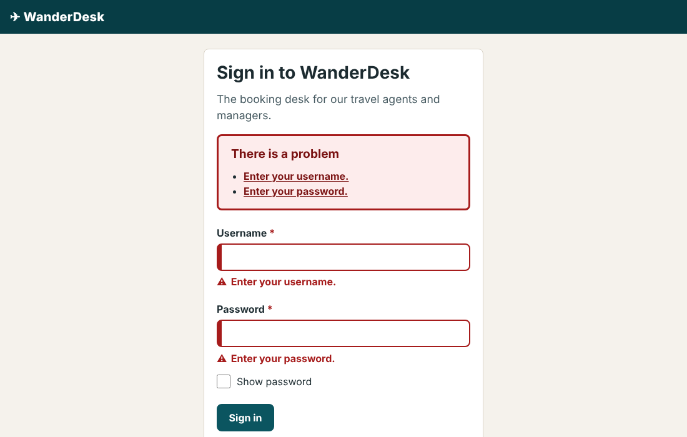
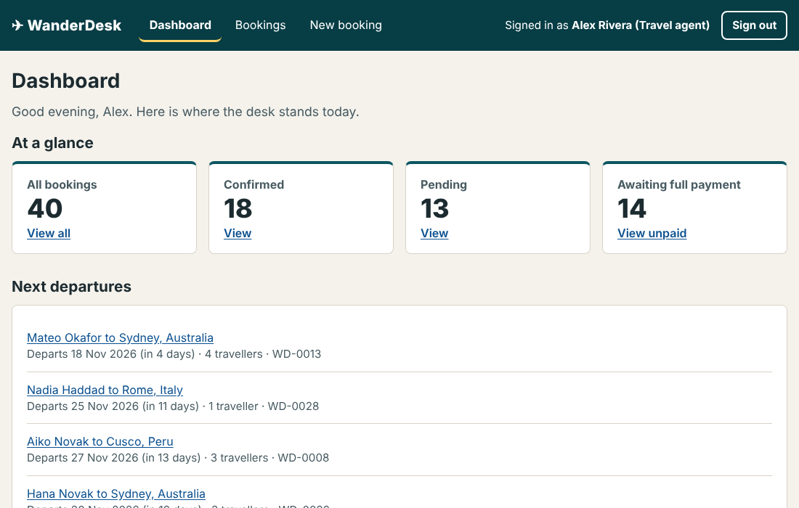
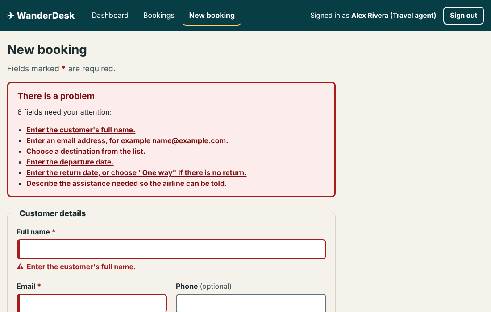
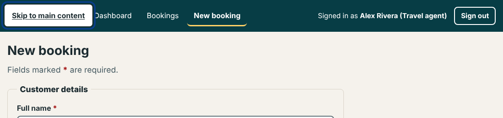
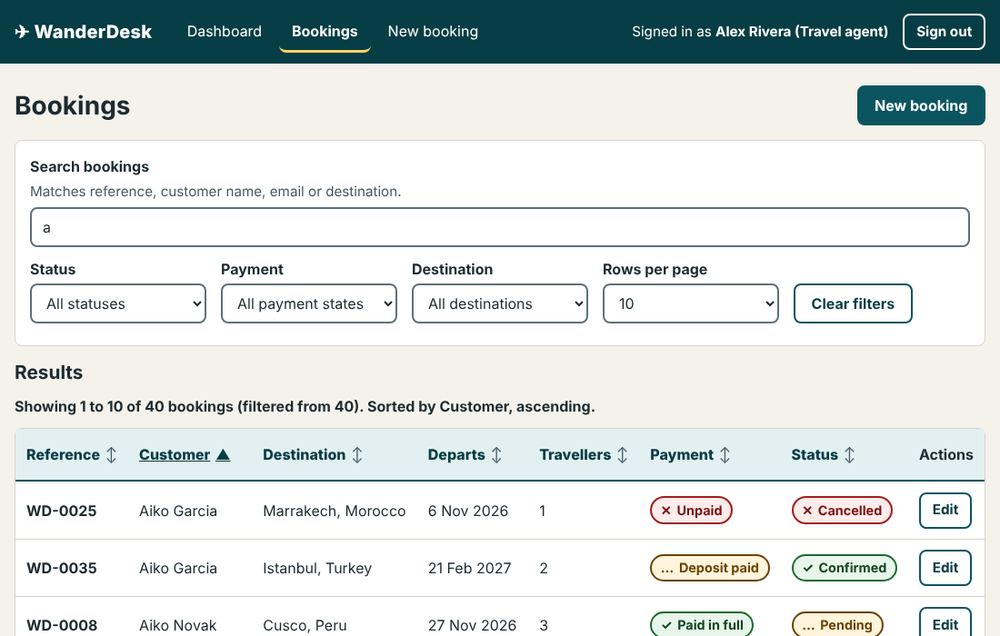
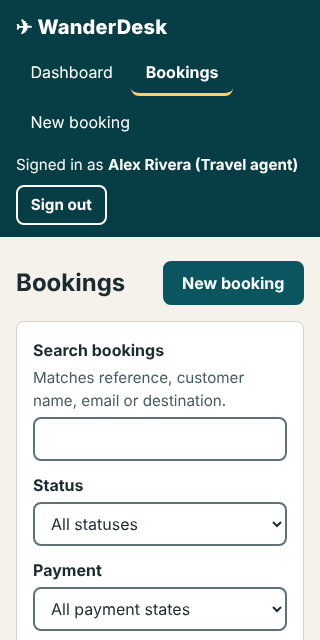

| | |
|---|---|
| **Module** | Accessibility and Usability |
| **Student** | Kareem Gehad / 202401901 |
| **Live URL** | `[ADD YOUR LIVE URL]` |
| **What it is** | A travel-agency booking desk: sign in, add and edit bookings, search and sort a table of records. |
| **Standard aimed for** | WCAG 2.1 Level AA |

# 1. Accessibility statement

| Requirement | WCAG criteria | How it is met (evidence) |
|---|---|---|
| **1. Semantic structure** | 1.3.1, 2.4.2, 2.4.6, 3.1.1 | Every page has `header`, labelled `nav`, `main` and `footer`; one `h1` and no skipped headings; unique page titles; `lang="en"`. Forms use `label`, `fieldset` and `legend`. The table has a caption, `th scope` and `aria-sort`. Checked by `tools/static-checks.js`. |
| **2. Keyboard operability** | 2.1.1, 2.1.2, 2.4.1, 2.4.3 | Only native links, buttons and fields are used. A "Skip to main content" link is the first tab stop. The delete dialog is a native `<dialog>` (focus stays inside, Esc closes it). Tabbing 40 times through the form shows no trap. |
| **3. Visible focus** | 2.4.7 | A 3 px outline with a 2 px offset on every control (yellow on the dark header). It is never removed. |
| **4. Meaningful ARIA** | 4.1.2, 4.1.3 | ARIA only fills gaps: `aria-sort`, `aria-invalid`, `aria-describedby`, `aria-current`, `aria-busy`. A polite status region announces loading, saving, saved, result counts and fields that appear. Errors use an alert region. Messages never auto-dismiss. |
| **5. Colour and contrast** | 1.4.1, 1.4.3, 1.4.11 | 31 colour pairs checked in `tools/contrast.js`, all pass (lowest text pair 6.2:1, borders 5.1:1, focus ring 9:1). Status badges use an icon plus text; invalid fields get a thick border plus a message. |
| **6. Zoom and reflow** | 1.4.4, 1.4.10, 1.4.12 | `rem` units and no fixed heights. No sideways scrolling at 640 px (200% zoom) or 320 px (400%). Text-spacing overrides cause no overflow. |
| **7. Responsive layout** | 1.4.10 | One layout from 320 px up. On small screens the table becomes stacked cards. |
| **Forms and errors** | 1.3.5, 3.2.2, 3.3.1 to 3.3.4 | Inline error plus a summary whose links jump to each field. Messages say how to fix the problem. Past dates and more than 9 travellers are blocked. Leaving a half-filled form shows the browser's unsaved-changes prompt. Delete asks for confirmation and offers Undo. |

**Known limitations**

* Some screen readers may stop announcing the table as a table in the stacked mobile layout.
* Date fields use the browser's own control, which varies between browsers.
* Sign-in is simulated, as the brief allows.

# 2. Evaluation

## 2.1 Automated testing

| Tool | Result |
|---|---|
| axe DevTools or WAVE | `[RUN ON ALL 4 PAGES: issues found / issues fixed / add screenshot]` |
| `tools/static-checks.js` (HTML structure lint) | 4 pages, 0 problems |
| `tools/contrast.js` | 31 of 31 pass |
| `tools/e2e-smoke.py` (Chrome: focus, announcements, form, table, delete and undo, roles, unsaved-changes prompt, reflow) | 77 of 77 pass |
| Chrome accessibility tree (inside `e2e-smoke.py`): every button, link and field has an accessible name, on all 4 pages | 0 unnamed controls |
| `npm test` (server, storage, validation, roles) | 10 of 10 pass |
| Table with 500 records (`npm run seed:large`) | Loads in about 0.2 s; 10 to 50 rows drawn at a time; sort and search stay instant |

## 2.2 Problem found and fixed

* **Problem:** after a failed sign-in, fixing the fields and clicking "Sign in" did nothing. The error text under the password field disappeared on blur, the button jumped up, and the click was lost. The booking form had the same flaw.
* **Fix:** errors now clear as the person types, blur-checking is skipped when focus moves to a button, and the submit button always validates. The test now passes.

## 2.3 Manual testing

| Check | Result |
|---|---|
| Keyboard only: sign in, add, search, sort, page, edit, delete, undo | Done without a mouse. |
| Focus visible on every stop | Yes (40 stops checked). |
| Screen reader | `[NAME THE READER AND BROWSER; note what was and was not announced]` |
| 200% zoom in your own browser | `[CONFIRM]` |

# 3. Usability choices (Nielsen's heuristics)

| Heuristic | What the interface does |
|---|---|
| System status | Spinner and text while loading or saving; live count such as "Showing 1 to 10 of 13 (filtered from 40)". |
| Consistency | Same buttons, labels and error pattern on every page. |
| Error prevention and recovery | Date and traveller limits, unsaved-changes prompt, delete confirmation (managers only, enforced on the server), Undo, specific messages. |
| Efficiency | Defaults (1 adult, return trip), "Save and add another", remembered search and sort, dashboard links to pre-filtered lists. |
| Recognition over recall | Demo accounts shown on sign-in; name and role always in the header; filters stay above the table. |

# 4. Screenshots

| Sign-in with errors | Dashboard |
|---|---|
|  |  |

| Booking form: error summary and inline errors | Skip link on first Tab press |
|---|---|
|  |  |

| Bookings table, sorted and filtered | Bookings at 320 px wide |
|---|---|
|  |  |
